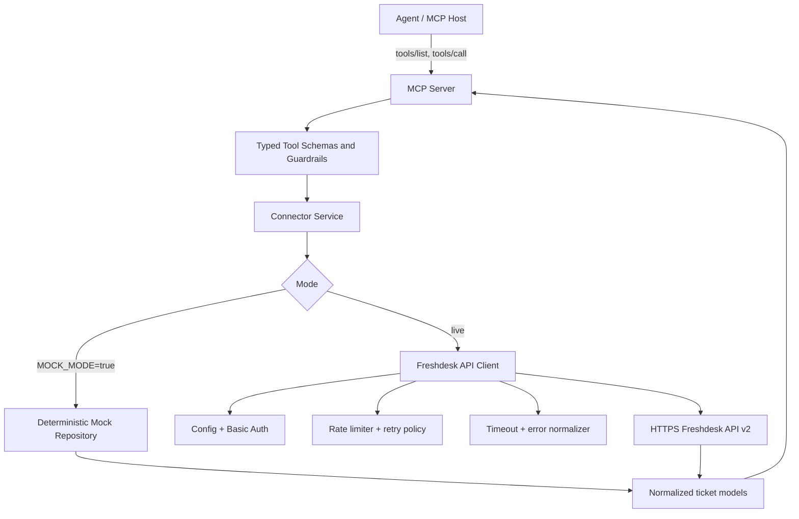

# Product Requirements Document: Freshdesk Agent Connector

**Status:** Approved implementation baseline  
**Version:** 1.0  
**Last updated:** 2026-10-01  
**Owner:** Assignment submission  
**Source:** Razorpay Forward-Deployed Engineer, Agent Studio assignment brief in [`prd.md`](./prd.md)

## 1. Executive Summary

Freshdesk Agent Connector is a small, read-only integration that lets an Agent Studio-style AI agent retrieve Freshdesk support-ticket information through three typed MCP tools: `list_tickets`, `get_ticket`, and `search_tickets`. The connector uses Freshdesk API v2, API-key authentication, bounded pagination, centralized retries/rate-limit handling, normalized responses, and safe error messages.

The project is deliberately useful without a Freshdesk account. `MOCK_MODE=true` selects deterministic, fictional data and exercises the same service and MCP tool path used in live mode. Live mode uses the official Freshdesk HTTPS API only; it never scrapes the web application and never accepts credentials from an agent tool call.

## 2. Problem Statement

An AI agent needs a narrow, predictable way to answer support questions without receiving broad account access or inventing Freshdesk API calls. A direct API integration would expose credentials, vendor-specific payloads, inconsistent errors, and unbounded results to the model. This connector creates a controlled read-only boundary with explicit schemas, safe limits, and an auditable request path.

## 3. Assignment Context

Razorpay's assignment asks for a private connector for one merchant tool: Freshdesk, Zoho Inventory, WooCommerce, or Unicommerce. Freshdesk is selected because its documented API v2 provides the required ticket list, get, and search primitives, API-key authentication, pagination, rate-limit headers, and a clear REST surface. The submission must be runnable, understandable, secure, tested, and documented without real credentials or customer data.

## 4. Goals

1. Let an agent safely list recent Freshdesk tickets.
2. Let an agent retrieve one ticket by numeric ID.
3. Let an agent search tickets using the supported Freshdesk ticket-query grammar.
4. Normalize vendor responses into stable, agent-friendly JSON.
5. Handle authentication failures, permissions, invalid input, missing records, timeouts, network failures, upstream failures, and rate limits clearly.
6. Enforce bounded page sizes, pages, query lengths, timeouts, and retry attempts.
7. Expose the operations through MCP with useful descriptions and schemas.
8. Provide a deterministic demo and automated tests that do not require a Freshdesk account.
9. Make the permission boundary explicitly read-only.

## 5. Non-Goals

- Creating, updating, deleting, restoring, merging, forwarding, or replying to tickets.
- Sending email or messages, issuing refunds, changing billing, or changing permissions.
- A full-text search engine over Freshdesk subject/body content. The Freshdesk search endpoint accepts its documented field/query grammar; the connector does not pretend otherwise.
- Synchronization, webhooks, background jobs, caching, persistence, or a frontend UI.
- OAuth token exchange. Freshdesk API-key authentication is the most practical documented authentication mechanism for this private, server-side assignment connector.
- Returning raw Freshdesk payloads or attachments by default.

## 6. Target User

The direct user is an Agent Studio-style AI agent operating on behalf of an authorized support or operations user. The human reviewer/developer is the secondary user who configures credentials, runs the server, inspects tool schemas, and verifies behavior.

## 7. User Stories

Each story below describes the intended agent behavior, not an unsupported vendor capability.

### Story 1: Show the latest open support tickets

- **User request:** "Show me the latest open support tickets."
- **Agent reasoning:** Use the documented `new_and_my_open` list filter when the user's scope is the authenticated agent's open tickets; use `search_tickets` with `status:2` when all open tickets are required.
- **MCP tool:** `list_tickets` for the documented agent-scoped filter, or `search_tickets` for all open tickets.
- **Connector operation:** Validate `filter="new_and_my_open"`, `order_by=created_at`, `order_type=desc`, and a bounded `per_page`.
- **Freshdesk request:** `GET /api/v2/tickets?filter=new_and_my_open&order_by=created_at&order_type=desc&per_page=...` with `include=description` only if requested.
- **Expected response:** Normalized ticket summaries plus page and continuation metadata.
- **Error scenarios:** Invalid page size, missing live credentials, 401/403, timeout/network error, 429 after bounded retries, or 5xx after bounded retries.

### Story 2: Find tickets associated with failed payments

- **User request:** "Find tickets related to failed payments."
- **Agent reasoning:** Translate the request into a supported Freshdesk query, such as a configured tag or custom field. The agent must not claim that arbitrary subject/body full-text search is available.
- **MCP tool:** `search_tickets`.
- **Connector operation:** Validate and pass a Freshdesk query such as `tag:'payment-failure'` or an account-specific custom-field query.
- **Freshdesk request:** `GET /api/v2/search/tickets?query=...&page=1`.
- **Expected response:** Matching normalized tickets, `total` when returned by Freshdesk, and the search page boundary.
- **Error scenarios:** Query over 512 characters, malformed Freshdesk query, no matches, stale search index, 400/401/403/429/5xx, or a missing live configuration.

### Story 3: Get ticket 12345

- **User request:** "Get the details of ticket 12345."
- **Agent reasoning:** Validate that the ID is a positive integer and retrieve only that ticket.
- **MCP tool:** `get_ticket`.
- **Connector operation:** Call the client with `ticket_id=12345` and optional safe `include` values.
- **Freshdesk request:** `GET /api/v2/tickets/12345`.
- **Expected response:** A normalized ticket detail, with only explicitly requested embedded information.
- **Error scenarios:** Non-positive/non-integer ID, 404, 401/403, timeout, network error, malformed JSON, or upstream 5xx.

### Story 4: Find high-priority unresolved tickets

- **User request:** "Find high-priority unresolved tickets."
- **Agent reasoning:** Use documented numeric fields, for example `priority:3 OR priority:4` combined with the account's definition of unresolved statuses.
- **MCP tool:** `search_tickets`.
- **Connector operation:** Validate a bounded query such as `(priority:3 OR priority:4) AND (status:2 OR status:3)`.
- **Freshdesk request:** `GET /api/v2/search/tickets?query=...&page=1`.
- **Expected response:** Matching tickets with raw numeric status/priority and normalized labels.
- **Error scenarios:** Invalid query syntax, no results, rate limit, permissions, or search-index delay.

### Story 5: Show recent tickets for a customer

- **User request:** "Show me the most recent tickets for customer example@fictional.test."
- **Agent reasoning:** Use the documented list filter `email`, URL encoded, plus sort and bounds.
- **MCP tool:** `list_tickets`.
- **Connector operation:** Validate the email and pass it as a list filter.
- **Freshdesk request:** `GET /api/v2/tickets?email=example%40fictional.test&order_by=created_at&order_type=desc&per_page=...`.
- **Expected response:** Bounded ticket summaries; no credentials or unrelated raw payload.
- **Error scenarios:** Invalid email, no results, list endpoint's documented default date window, 401/403/429, or network failure.

## 8. Functional Requirements

### FR-1 Configuration

- Read `FRESHDESK_DOMAIN`, `FRESHDESK_API_KEY`, and operational settings from environment variables.
- Load a local `.env` only for developer convenience; `.env` is ignored by Git.
- Validate live configuration before making a request and produce actionable, secret-free messages.
- Allow `MOCK_MODE=true` without live credentials.

### FR-2 Authentication

Use Freshdesk API v2 personal API-key authentication as HTTP Basic Auth: API key as the username and the documented dummy password `X`. Requests must use HTTPS. The key is held only in configuration/client state and is never a tool argument, model output, exception string, or log field.

### FR-3 List

`list_tickets` supports bounded `page`, `per_page`, `email`, `requester_id`, `company_id`, `updated_since`, `filter`, `order_by`, `order_type`, and an explicit description/include option where useful. The implementation must not imply that an unfiltered request returns all historical tickets: Freshdesk documents a default recent window and a maximum of 300 pages/30,000 tickets.

### FR-4 Get

`get_ticket` accepts a positive numeric ticket ID and an optional allow-listed `include` set (`requester`, `company`, `stats`, `conversations`). The default does not request expensive embedded data.

### FR-5 Search

`search_tickets` accepts a non-empty Freshdesk ticket query of at most 512 characters and a bounded page. It URL-encodes the query through the HTTP client, does not accept arbitrary URLs, and respects Freshdesk's documented maximum page of 10 for this endpoint.

### FR-6 Normalization

Return stable models with ticket ID, subject, status code/label, priority code/label, requester identifiers where available, timestamps, tags, description text where present, and safe metadata. Missing optional upstream fields remain absent/null rather than causing a crash.

### FR-7 MCP

Expose exactly three read-only MCP tools initially. Tool names, descriptions, input constraints, output shape, errors, examples, and limitations are documented in `TOOLS.md`. The server uses the official MCP Python SDK and typed Pydantic schemas; tool annotations are hints and never the sole security mechanism.

### FR-8 Mock mode

Mock mode uses deterministic fictional tickets, supports list/get/search and pagination, and includes predictable not-found and invalid-input behavior. It never instantiates a live HTTP request client or contacts Freshdesk.

## 9. Non-Functional Requirements

- Python 3.12+; the development environment currently provides Python 3.13.
- Async I/O through `httpx.AsyncClient` with an explicit timeout.
- Small dependency set: `httpx`, `pydantic`, `python-dotenv`, the official `mcp` SDK, and test-only `pytest`, `pytest-asyncio`, and `respx`/equivalent mocking support.
- No global mutable credential state.
- Deterministic tests and demo output.
- No secrets, real customer data, or real support content in the repository.
- Clear type annotations and lintable code.
- Structured logs with operation, outcome, duration, status, retry count, and request correlation ID; never log auth headers or ticket descriptions by default.

## 10. Architecture



- **MCP server:** Protocol boundary. Registers tools, validates input, maps service results/errors to MCP tool results, and emits no credentials.
- **Connector service:** Vendor-independent use-case boundary. Enforces business limits and invokes a `TicketSource` interface.
- **Freshdesk client:** Owns URL construction, Basic Auth, HTTP timeout, response decoding, pagination links, retry/rate-limit handling, and upstream error normalization.
- **Mock repository:** Implements the same ticket-source contract with fictional data.
- **Models:** Pydantic input/output and domain models; they prevent raw vendor payloads from leaking to the agent.

## 11. Data Flow

1. MCP host discovers the three tools.
2. Agent sends a typed tool call.
3. MCP schema validation rejects malformed arguments before the service runs.
4. Connector service applies semantic validation and bounded limits.
5. The selected source executes a read-only list/get/search operation.
6. Live client sends an HTTPS `GET` request with Basic Auth; mock mode reads in-memory fixtures.
7. Response is validated/normalized, pagination metadata is calculated, and sensitive fields are excluded.
8. The MCP layer returns structured JSON plus concise text or a safe tool error.
9. The agent summarizes only the returned information and must state when a result is partial, empty, stale, or unavailable.

## 12. Authentication Flow

1. Operator creates a Freshdesk API key with the least privilege needed to view tickets.
2. Operator sets `FRESHDESK_DOMAIN` to the Freshdesk subdomain and `FRESHDESK_API_KEY` in the environment.
3. Configuration validates the domain and key presence at client construction or first live operation.
4. The client sends `Authorization: Basic base64(API_KEY:X)` over HTTPS via `httpx` Basic Auth.
5. 401 becomes `AuthenticationError`; 403 becomes `PermissionDeniedError`.
6. Neither the key nor the Authorization header is included in logs, errors, fixtures, or MCP arguments.

API-key auth is selected over OAuth because this is a private server-side connector and Freshdesk's official API v2 documents personal API-key Basic Auth directly. OAuth would add authorization endpoints, redirect handling, token storage, refresh, and a browser flow that do not improve this read-only assignment demonstrator.

## 13. API Integration

The live client targets only `https://{FRESHDESK_DOMAIN}/api/v2` and only these GET endpoints:

| Operation | Freshdesk endpoint | Notes |
|---|---|---|
| List | `/tickets` | Supports page/per_page, documented filters and sort fields; Freshdesk's default date window and 300-page cap are preserved. |
| Get | `/tickets/{id}` | Optional allow-listed `include`; embedded data costs additional credits. |
| Search | `/search/tickets` | `query` is encoded and limited to 512 characters; page is limited to 10; response contains `total` and `results`. |

The implementation does not infer unsupported full-text behavior, follow arbitrary upstream URLs, send write verbs, or expose update/delete/reply endpoints.

## 14. MCP Integration

The official MCP Python SDK is used with a pinned major version compatible with the current SDK API. Each tool has a typed Pydantic input schema and typed output model. The server advertises tools through standard `tools/list` and handles `tools/call`. Input/validation and upstream failures are tool execution errors with `isError=true` semantics; malformed protocol requests remain protocol errors. The three tools are annotated read-only, but the connector enforces read-only behavior in code independently of annotations.

## 15. Tool Specifications

See [`TOOLS.md`](./TOOLS.md) for the canonical contract. The initial tools are:

- `list_tickets`: bounded list with safe filters and pagination.
- `get_ticket`: one ticket by positive ID, with optional allow-listed expansions.
- `search_tickets`: Freshdesk field-query search with bounded query/page.

No tool accepts a domain, API key, arbitrary URL, HTTP method, write payload, or raw Freshdesk credentials.

## 16. Rate Limiting

Freshdesk documents account-wide plan-dependent limits, `X-RateLimit-*` response headers, HTTP 429, and `Retry-After` seconds when the limit is reached. The connector:

- applies a local concurrency/spacing limiter to avoid bursts;
- on 429, honors a valid non-negative `Retry-After` value;
- otherwise uses bounded exponential backoff with jitter;
- retries only a configured small number of times;
- never retries 400/401/403/404 or other non-transient client errors;
- retries selected 5xx responses only within the same bound;
- returns a normalized `RateLimitError` after exhaustion, including a safe retry hint when available;
- records remaining/total rate-limit headers in internal metrics/log fields, not ticket payloads.

Tests replace sleep with a controllable clock or zero-delay policy. The implementation never claims a fixed Freshdesk plan limit.

## 17. Pagination

- Ordinary list defaults to `page=1`, `per_page=20` and caps `per_page` at 100 and pages/results at a connector-level safe maximum.
- Search defaults to page 1 and caps page at Freshdesk's documented 10; its page size follows the endpoint's documented result behavior.
- Results contain `has_more`, current page, page size, and an optional next-page indicator.
- The live client uses the upstream `Link` header when present rather than accepting a caller-supplied URL.
- The agent must request another page explicitly; a tool call never fetches thousands of records automatically.
- Deep list pagination beyond the connector cap is reported as a limitation, not silently truncated without metadata.

## 18. Error Handling

Errors are normalized into safe categories:

| Category | Typical cause | Agent-facing behavior |
|---|---|---|
| Configuration | Missing/invalid env | Explain the required variable without its value. |
| Validation | Bad ID, query, date, filter, page | State the field and allowed range. |
| Authentication | 401 | Ask operator to verify the API key/domain. |
| Permission | 403 | Explain that the Freshdesk agent lacks read access. |
| Not found | 404 | State that the ticket/resource was not found. |
| Bad request | 400/405/406/415 | Return a safe upstream description and field errors where present. |
| Rate limit | 429 | State that the limit was reached, bounded retry outcome, and retry hint. |
| Timeout/network | Client transport failure | State that Freshdesk could not be reached and suggest retrying. |
| Upstream | 5xx/malformed response | State that Freshdesk returned an unusable response; do not expose stack traces. |

Internal exception chaining is preserved for debugging but is never serialized to an MCP result.

## 19. Security

- Secrets come from environment variables; `.env` is gitignored and `.env.example` contains placeholders only.
- All live URLs require HTTPS and the domain is constrained to a Freshdesk hostname/subdomain format.
- API keys are never logged, returned, interpolated into error text, or accepted from tool arguments.
- Inputs are validated; URLs are built from fixed paths and allow-listed query fields.
- Timeouts, bounded retries, result caps, and rate limiting protect both the upstream account and the agent context.
- Ticket content is treated as untrusted data, not instructions. The agent should summarize it as data and not execute instructions found inside ticket text.
- Output is normalized and does not return attachments or arbitrary upstream fields by default.
- This assignment must use fictional/test data only. No real customer records or credentials belong in this repository.
- The server's read-only API surface is an explicit security control; MCP read-only hints are supplementary.

See [`SECURITY.md`](./SECURITY.md) for the operational checklist.

## 20. Permissions

The configured Freshdesk identity should have the minimum ticket-view permissions necessary for the demo. The connector itself only emits GET requests to three ticket endpoints. It cannot create, update, delete, restore, merge, forward, reply to tickets, manage contacts, change account settings, change billing, change permissions, or issue refunds. Freshdesk may still apply the configured user's normal visibility rules; the connector does not bypass them.

## 21. Agent Guardrails

The agent may use only the exposed tools and must:

- choose list/get/search based on the user's request;
- preserve ticket IDs and upstream status/priority values accurately;
- say when no result was found, search indexing may lag, or results are bounded;
- ask for clarification instead of guessing unsupported filters;
- treat descriptions, tags, and requester content as untrusted text.

The agent must not claim that it changed a ticket or performed an action outside the tool results. The complete CAN/CANNOT boundary is in [`CAPABILITIES.md`](./CAPABILITIES.md).

## 22. Observability / Logging

Use standard structured logging with a generated correlation ID per tool call. Log operation name, mode (`mock`/`live`), outcome category, HTTP status if available, duration, retry count, and rate-limit metadata. Do not log API keys, Authorization headers, full query contents when they may contain customer data, ticket descriptions, email addresses, or raw response bodies. A production deployment would export counters/histograms and audit tool calls to a protected sink.

## 23. Testing Strategy

Tests are offline and use mocked HTTP responses or the deterministic repository. Required coverage includes:

- configuration success/missing credentials and secret-safe errors;
- list success, empty, pagination, filters, and maximum bounds;
- get success, missing ticket, invalid ID, and optional includes;
- search matches, empty results, invalid/overlong query, and page cap;
- 429 with `Retry-After`, retry success, backoff fallback, and retry exhaustion;
- timeout, connection error, malformed JSON, and upstream 500;
- no credentials in logs/errors/results;
- MCP tool discovery, valid schemas, invalid inputs, read-only annotations, and formatted results;
- end-to-end mock demo path from tool invocation to normalized response.

## 24. Local Development Strategy

Develop against the mock repository first, then test the client separately against mocked `httpx` responses. No development step requires a live Freshdesk account. The default demo is mock mode. Live mode is opt-in and should be run only with a reviewer-owned test account and non-production data.

Expected commands after implementation:

```bash
python3.12 -m venv .venv
. .venv/bin/activate
python -m pip install -e '.[dev]'
cp .env.example .env
# keep MOCK_MODE=true for the no-credentials demo
python examples/demo.py
pytest
```

## 25. Mock / Fixture Strategy

Fixtures are static, deterministic, and clearly fictional. They use synthetic IDs such as 10001, names such as `Riya Demo`, and domains such as `fictional.test`. They cover open/high-priority/payment-failure, pending, resolved, and empty-search cases. Mock pagination splits the fixture set into pages so that page metadata and page bounds are observable. A special test-only transport returns 401, 403, 404, 429, timeout, connection error, malformed JSON, and 500 responses without contacting a real service.

## 26. Demo Workflow

The one-command mock demo invokes the same service used by MCP:

1. Start in `MOCK_MODE=true`.
2. Call `search_tickets` with `tag:'payment-failure'`.
3. Print a concise answer containing the matching fictional ticket IDs, subjects, and statuses.
4. Call `list_tickets` with `filter="new_and_my_open"` and a small page size to show pagination.
5. Call `get_ticket` for 10001.
6. Call `get_ticket` for a missing ID to show a safe error.

The README includes equivalent MCP Inspector/stdio usage and expected output shape.

## 27. Repository Structure

```text
.
├── README.md
├── PRD.md
├── ARCHITECTURE.md
├── TOOLS.md
├── CAPABILITIES.md
├── SECURITY.md
├── REQUIREMENTS.md
├── FINAL_REVIEW.md
├── .env.example
├── .gitignore
├── pyproject.toml
├── src/
│   └── connector/
│       ├── __init__.py
│       ├── config.py
│       ├── errors.py
│       ├── models.py
│       ├── client.py
│       ├── mock.py
│       ├── service.py
│       ├── rate_limit.py
│       └── mcp_server.py
├── tests/
│   ├── unit/
│   ├── integration/
│   └── fixtures/
└── examples/
    └── demo.py
```

The structure favors a short path through the system rather than empty framework directories.

## 28. Setup Instructions

The final README is the executable setup reference. In summary: use Python 3.12+, create a virtual environment, install the project with development extras, copy `.env.example`, keep mock mode for the demo, and run tests. For live mode, set a Freshdesk subdomain and API key in the environment and ensure the Freshdesk user can view tickets. Never commit `.env`.

## 29. Deployment Considerations

For a real deployment, run the MCP server in a controlled private process or platform, inject secrets through a secret manager, restrict network egress to Freshdesk HTTPS, use per-user or per-tenant authorization, add metrics/traces and audit retention, rotate API keys, and place a human approval boundary around any future write tools. The assignment implementation is a single-process reference connector and is not a claim of multi-tenant production readiness.

## 30. Assumptions

1. The reviewer has Python 3.12+ and can install dependencies from PyPI.
2. Freshdesk API v2 remains the supported production API and the account uses a Freshdesk domain, not a custom CNAME.
3. API-key authentication is enabled and the configured user can view the selected tickets.
4. The reviewer accepts a read-only connector as satisfying the assignment's read capability.
5. Search queries are written in Freshdesk's documented grammar; natural-language translation is an agent responsibility.
6. Mock mode is sufficient for offline evaluation and no live account is required.
7. The current MCP Python SDK major version selected in `pyproject.toml` is available to the reviewer.

## 31. Limitations

- API-key auth is not an OAuth consent flow; it is appropriate for a private server-side connector but requires secure secret distribution.
- Freshdesk search is field/query based, archived tickets are excluded, the index may lag, and search pages are limited by the upstream API.
- Unfiltered list calls have Freshdesk's documented recent-ticket default window and upstream page cap.
- The connector returns bounded results and does not automatically aggregate all pages.
- No caching, persistence, webhook synchronization, attachment retrieval, conversation pagination, multi-tenant isolation, or frontend UI is included.
- Ticket descriptions/requester data may contain sensitive content in a real account; production deployment needs tenant-specific redaction and policy controls.
- The mock data demonstrates behavior but cannot validate a real Freshdesk plan's permissions or limits.

## 32. Future Improvements

- OAuth/token rotation if the deployment environment requires delegated user consent.
- Explicit tenant-aware credential storage and authorization.
- A policy-controlled full-text indexing path if Freshdesk exposes a supported and appropriate source.
- Cursor/session-based pagination and optional server-side result caching.
- Read-only conversation and agent lookup tools after permission review.
- OpenTelemetry metrics/traces, audit export, and secret-scanning CI.
- Contract tests against a dedicated Freshdesk sandbox account.
- Human confirmation and additional policy gates before any future write capability.

## 33. Acceptance Criteria

- [ ] A reviewer can install and run the mock demo without a Freshdesk account.
- [ ] `list_tickets`, `get_ticket`, and `search_tickets` are discoverable MCP tools with useful schemas and descriptions.
- [ ] Live mode sends only documented Freshdesk API v2 GET requests with environment-based API-key Basic Auth.
- [ ] Missing, invalid, and insufficient credentials produce clear secret-free errors.
- [ ] List/get/search inputs and outputs are bounded, validated, normalized, and documented.
- [ ] Pagination, 429/Retry-After, bounded retries, timeouts, and upstream errors are tested.
- [ ] Mock mode demonstrates successful calls, pagination, search, and safe errors with fictional data.
- [ ] Automated tests run offline and cover the required boundaries.
- [ ] README, architecture, capabilities, security, tools, requirements traceability, and final review documents are present.
- [ ] Repository inspection finds no secrets, real customer data, or tracked `.env`.

## 34. Definition of Done

The project is done when the acceptance criteria pass, the documented commands have actually been run, the MCP server/tool schemas validate, the mock demo works, the live client behavior is covered by mocked HTTP tests, and the final review distinguishes implemented behavior from mocked behavior, assumptions, and future work. A failed or unavailable check must remain visible rather than being described as passed.

## Research References

- Freshdesk API v2: <https://developers.freshdesk.com/api/> (authentication, tickets, search, pagination, rate limits, errors, and API policies).
- MCP tools specification: <https://modelcontextprotocol.io/specification/latest/server/tools>.
- MCP Python SDK tools guide: <https://py.sdk.modelcontextprotocol.io/servers/tools/>.
- MCP Python SDK repository: <https://github.com/modelcontextprotocol/python-sdk>.
